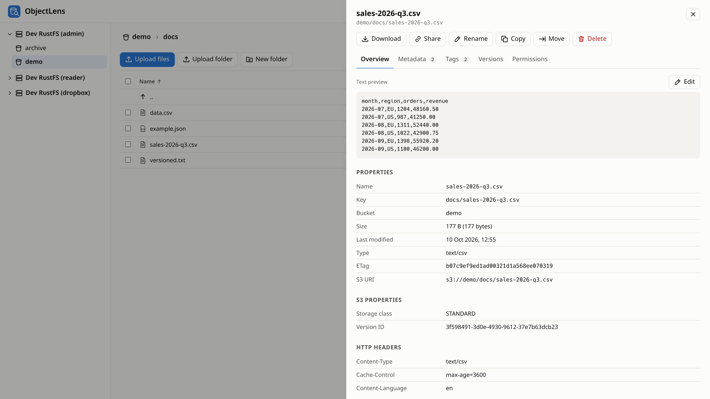

# ObjectLens

A file explorer for S3 and S3-compatible object storage (AWS S3, RustFS, MinIO, Ceph RGW, Garage,
Cloudflare R2, …) that runs on your own machine and opens in the browser.

> [!NOTE]
> This project was created with [Anthropic Claude Opus 5.5](https://www.anthropic.com/claude).



- **Browse** buckets and folders, page through large folders, sort, filter, and search a whole
  subtree by name.
- **Read and write**: upload files and whole folders (drag and drop, multipart, with progress),
  download, create folders, rename, copy and move (also between buckets), delete, edit text files
  in place, create, empty and delete buckets.
- **Properties**: size, dates, ETag, content type and HTTP headers; S3 properties (storage class,
  version, encryption and KMS key, object lock, legal hold, replication, checksums, restore and
  archive state, multipart parts); user metadata (`x-amz-meta-*`), tags and ACLs, all editable
  where S3 allows it; previews of images, audio, video, PDF and text.
- **Versions**: list the versions and delete markers of an object, view, download or restore an
  old version, delete versions for good.
- **Bucket properties**: region, versioning (enable/suspend), tags, encryption, policy and public
  access, ownership, ACL, object lock, lifecycle, replication, CORS, website, logging and
  notifications.
- **Permission-aware**: what the credentials may not do is greyed out, with the reason. S3 has no
  "what may I do" call, so ObjectLens finds out with side-effect-free probes and learns from
  denied requests (see [DECISIONS.md](DECISIONS.md#d4-greying-out-what-the-credentials-may-not-do)).
- **Share links**: presigned download URLs, valid up to 7 days.
- **kopia backups** (read-only): a folder holding a [kopia](https://kopia.io) repository shows
  its snapshots, including the checkpoints of uploads still running; browse them, see file
  permissions and owners, preview and download files. The repository's own objects are
  protected from changes (see [kopia backups](#kopia-backups)).
- **Velero backups** (read-only): a [Velero](https://velero.io) backup location shows its
  backups, what each holds (resources, manifests, errors, log), and its volumes; **Browse files**
  opens a volume's data as of that backup (see [Velero backups](#velero-backups)).

Credentials stay on the server side of ObjectLens; the browser only talks to ObjectLens.

## Quick start

Requires Node 26 (`.nvmrc`).

```sh
npm ci
cp .env.example .env        # then set S3_1_ENDPOINT, S3_1_ACCESS_KEY_ID, S3_1_SECRET_ACCESS_KEY
npm run build
npm start                   # http://127.0.0.1:3000
```

Or with Docker:

```sh
docker run --rm -p 127.0.0.1:3000:3000 --env-file .env ghcr.io/sebastka/objectlens:latest
```

**ObjectLens has no login.** It is meant for your own machine: anyone who can reach it can use
its S3 credentials. It listens on `127.0.0.1` by default; keep it there (or behind your own
authenticating proxy). Requests from other web sites are refused (see
[Security](#security)).

## Configuration

Everything is configured in the environment (or `.env`); see [.env.example](.env.example) for
every option. A mistake stops the server with a list of all problems.

Connections are numbered blocks, `S3_<n>_*`:

| Variable                                       | Meaning                                                                            |
| ---------------------------------------------- | ---------------------------------------------------------------------------------- |
| `S3_n_ENDPOINT`                                | S3 API endpoint; unset for AWS                                                     |
| `S3_n_ACCESS_KEY_ID`, `S3_n_SECRET_ACCESS_KEY` | Credentials; unset = AWS default chain (environment, `~/.aws`, SSO, instance role) |
| `S3_n_SESSION_TOKEN` / `S3_n_PROFILE`          | Temporary credentials / a profile of `~/.aws/config`                               |
| `S3_n_REGION`                                  | Default `us-east-1`; buckets in other regions are followed                         |
| `S3_n_NAME`, `S3_n_ID`                         | Display name; id in URLs (default `n`)                                             |
| `S3_n_BUCKETS`, `S3_n_LIST_BUCKETS`            | Buckets to show when the credentials may not list buckets                          |
| `S3_n_READ_ONLY`                               | Never write through this connection                                                |
| `S3_n_PROBE`                                   | Permission probes for write, delete and tagging (default on)                       |
| `S3_n_SHARE_LINKS`, `S3_n_PUBLIC_ENDPOINT`     | Presigned links (default on), and the host name to put in them                     |
| `S3_n_FORCE_PATH_STYLE`                        | Path-style URLs (default on with an endpoint, off for AWS)                         |
| `S3_n_TLS_REJECT_UNAUTHORIZED`                 | `false` accepts self-signed certificates (prefer `NODE_EXTRA_CA_CERTS`)            |
| `S3_n_KOPIA_PASSWORD` / `…_FILE`               | Password of the kopia repositories on this connection (else typed in the UI)       |
| `S3_n_VELERO_PASSWORD` / `…_FILE`              | Password of Velero's kopia repositories (else Velero's default, then the UI)       |

Several connections to the same endpoint with different credentials are fine: each is shown
with its own permissions.

## How things work

- **Folders** are key prefixes ending in `/`. "New folder" creates an empty `folder/` marker
  object, as the AWS console does. Copying, moving or deleting a folder does it to every object
  below it. The server handles at most `BULK_LIMIT` (10,000) objects per request; the UI keeps
  going until the job is done.
- **Rename and move** are a server-side copy followed by a delete (S3 has no rename). Copies keep
  metadata, tags, storage class, encryption and ACL, but not Object Lock retention. Objects
  over 5 GiB are copied in parts.
- **Metadata edits** copy the object onto itself (S3 cannot change metadata in place): in a
  versioned bucket that creates a new version. Tags are changed in place.
- **Uploads and downloads** stream through ObjectLens, so they work with endpoints the browser
  cannot reach (and need no CORS configuration on the buckets). Uploads refuse to overwrite an
  existing object unless you confirm.
- **Deleting in a versioned bucket** adds delete markers; the data stays as older versions. The
  delete dialog can remove every version too.

## kopia backups

ObjectLens recognises a folder (or bucket) holding a kopia repository by its `kopia.repository`
object and offers **Browse backups**. Reading goes through the kopia CLI, which must be
installed where ObjectLens runs (the container image includes it; locally e.g.
`nix shell nixpkgs#kopia`, or `KOPIA_BIN=/path/to/kopia`):

- the connection is **read-only** (`kopia repository connect --readonly`): nothing is ever written
  to the repository;
- the **password** comes from `S3_n_KOPIA_PASSWORD` (or `S3_n_KOPIA_PASSWORD_FILE`), or is typed
  in the UI and kept in memory only, until a restart or **Lock**; it is never written to disk;
- kopia keeps a configuration (which holds the connection's S3 keys) and a cache of up to
  ~750 MB per repository in `KOPIA_DIR` (default `~/.cache/objectlens/kopia`, private to the
  user); **Lock** removes them;
- the repository's own objects cannot be uploaded, deleted, renamed or edited through ObjectLens:
  a changed blob corrupts the backups. Deleting the whole folder from its parent stays possible.

Listing snapshots and opening a folder take about a second the first time (one kopia process
each); folders are then cached, since kopia's object IDs are content hashes. Files are streamed
from `kopia show`: previews of large videos cannot seek.

## Velero backups

A folder (or bucket) with Velero's layout (`backups/<name>/velero-backup.json`) is a backup
location: ObjectLens offers **Velero backups** there.

- **Backups**: status, schedule, start, duration, expiry, items, errors and warnings, scope.
- **A backup**: its settings, errors and warnings, log, the backed-up resources and their stored
  manifests, and its **volumes**: data mover and file-system backups (kopia) can be browsed and
  downloaded file by file; CSI and provider snapshots stay in the cluster and are only listed.
  The volumes come from Velero's `volumeinfo`, or, where it is empty (data mover backups of
  Velero 1.18), from the DataUploads stored in the backup's tarball.
- **Volume data** lives in one kopia repository per namespace (`kopia/<namespace>/`), opened
  read-only as above. Its password: `S3_n_VELERO_PASSWORD`, else Velero's built-in default
  (`static-passw0rd`, with a warning: anyone who can read the bucket can then decrypt the
  backups), else typed in the UI.
- Velero's folders are read-only in ObjectLens; restoring is Velero's job.

## Security

- No login (by design, see above); `LISTEN_HOST` defaults to `127.0.0.1`, and a warning is
  logged otherwise.
- **DNS rebinding**: requests whose `Host` is not `localhost`, `127.0.0.1`, `[::1]`, the listen
  address or one of `ALLOWED_HOSTS` are refused.
- **CSRF**: requests that change anything must be same-origin (Fetch Metadata / `Origin`) and
  carry an `X-ObjectLens` header, which plain forms on other sites cannot send.
- **Previews never run content**: files are served with `X-Content-Type-Options: nosniff`, as
  attachments unless they are an image, audio, video, PDF or text preview, and inside a
  `Content-Security-Policy: sandbox` (except PDFs, which Chrome cannot show sandboxed). Text,
  HTML included, is served as `text/plain`. An uploaded HTML or SVG file cannot run script in
  ObjectLens' origin.
- Every change is logged to stdout (`[write] connection/bucket: …`).
- **kopia** runs with only the variables it needs (its password and the connection's keys), never
  with ObjectLens' whole environment, and object IDs are checked before they reach its command
  line.

## Development

```sh
npm ci
npm run dev:s3   # RustFS in Docker on 127.0.0.1:9400, with demo buckets and restricted users
npm run dev      # API on :3000 (watch mode) + Vite on http://localhost:5173
npm run check    # typecheck, lint, format check, tests
```

`npm run dev:s3` starts [RustFS](https://github.com/rustfs/rustfs) from
[compose.yaml](compose.yaml) and runs [dev/s3-init.sh](dev/s3-init.sh): buckets `demo`
(versioned) and `archive`, a read-only user `reader` / `reader-secret`, and a user `dropbox` /
`dropbox-secret` who may read `demo` but write only in `demo/inbox/`. Add them as connections 2
and 3 to see the permission handling. Docker publishes the port on `CONTAINER_HOST_ADDRESS`
(default `127.0.0.1`).

The integration tests run against that server when `TEST_S3_ENDPOINT` is set
(`http://127.0.0.1:9400`); they create and remove buckets of their own. The kopia tests also need
a kopia binary: `npm run kopia:bin` exports the one pinned in the Dockerfile to
`build/kopia/kopia` (or set `TEST_KOPIA_BIN`).

Stack: Hono API and React 19 / Vite UI, Node 26 running the TypeScript server directly (type
stripping), the AWS SDK v3. No database.

## Releases

Every push to `master` builds, after the checks:

- a signed release archive (`objectlens.tar.xz`, cosign keyless + SHA-256) with the same `/app`
  layout as the image; run it with `node src/server/index.ts` on Node 26;
- a multi-arch image `ghcr.io/sebastka/objectlens:<date>-<sha>` and `:latest`, with SBOM and
  provenance attestations, signed with cosign.

Verify an archive:

```sh
cosign verify-blob objectlens.tar.xz \
  --bundle objectlens.tar.xz.cosign.bundle \
  --certificate-identity-regexp '^https://github.com/sebastka/objectlens/' \
  --certificate-oidc-issuer https://token.actions.githubusercontent.com
sha256sum -c objectlens.tar.xz.sha256
```

Design decisions are in [DECISIONS.md](DECISIONS.md).

## License

[MIT](LICENSE)
